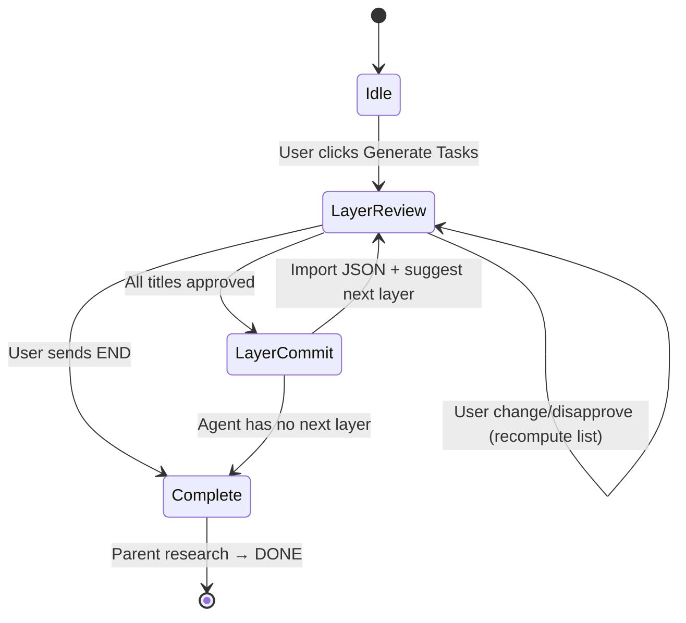

# Layered Generate Tasks — protocol

This document specifies behavior for the **new Generate Tasks** flow. Implementation tasks are in [TASKS.md](./TASKS.md).

## Session lifecycle



1. **Start** — User clicks **Generate Tasks** on a **research** task (primary case). Battleplan sets parent research status to **DOING** (if not already) and enters **Generate Tasks session** mode.
2. **Propose layer** — Agent sends a **numbered list of titles only** for the current layer (no full JSON yet).
3. **User review** — For each numbered item, user responds with:
   - `approve` (or `approve 1,3,5`)
   - `disapprove` (or `disapprove 2`)
   - `change N: <new intent>` (free text for item N)
4. **Recompute** — If any **change** or **disapprove**, agent recomputes the full numbered list for **this layer only** and re-presents it. **Disapproved** items are removed; **change** replaces intent/title as specified.
5. **Layer commit** — When **every remaining** item is **approved**:
   - Agent writes **task brief specs** under git (see [Git artifacts](#git-artifacts)).
   - Agent replies with **layer JSON** (see [JSON contract](#json-contract-per-layer)).
   - Battleplan **imports** JSON (existing `importGeneratedTasksFromReply` path), refreshes mindmap, reloads tasks.
6. **Next layer** — Agent proposes layer **N+1** titles (children of layer **N** tasks where meaningful). Not every layer-N task must get children.
7. **End** — User sends **`END`**, or agent determines no further meaningful layers. Battleplan exits session mode; parent research → **DONE**.

## Layer definitions

| Layer | Parent linkage in mindmap |
|-------|---------------------------|
| **1** | Tasks are **direct children** of the **source research task** (same as today’s anchoring via `prepareGeneratedDrafts` + `linkCreatedTasksUnderParent`) |
| **2+** | Each new task’s `depends_on` lists **exactly one** parent title from the **previous layer** (or explicit multi-parent only when spec requires fan-in) |

Agent must **not** suggest child tasks for every parent; only where dependency is real.

## Chat message formats

### Agent — layer proposal (titles only)

```text
Generate Tasks — Layer 2 (suggested)

1. Validate API schema against OpenAPI fixture
2. Add mindmap shape regression snapshots
3. Wire session state to local storage

Reply with approve/disapprove/change per number, or END to finish.
```

### User — examples

```text
approve 1,2
disapprove 3
change 2: Add Vitest coverage for mindmap shape CSS classes only
```

After partial review, agent **must** echo the **full revised numbered list**, not a delta-only patch.

### Agent — layer commit (after all approved)

1. Create/update files in git under `research/{project_id}/{child_task_id}/` (see below).
2. Final message contains **only** the JSON block (no markdown wrapper) or a `.json` artifact Battleplan already parses:

```json
{
  "layer": 1,
  "source_research_task_id": "<uuid>",
  "tasks": [ ... ],
  "edges": []
}
```

Battleplan ignores unknown top-level keys if needed; **`tasks`** (and optional **`edges`**) remain the import surface (`parse-tasks.ts`).

## JSON contract (per layer)

Each object in **`tasks`** should follow existing Generate Tasks rules (`docs/GENERATE_TASKS.md`, `generate-tasks.ts`):

| Field | Layer workflow usage |
|-------|----------------------|
| `title` | Approved title from grilling |
| `prompt` | Initial execute prompt (can mirror brief goal) |
| `task_kind` | `brainstorming` \| `research` \| `critiquing` \| `code` \| `architect` |
| `brief` | Full pstack object; `acceptance` should cite `research/{project_id}/{task_id}/` |
| `depends_on` | Layer 1: `[]` (anchored under research task by app). Layer 2+: parent title(s) from previous layer |
| `repo_path` | **New (recommended)** explicit git folder; see below |

Optional **`edges`** for fork/join/cycle unchanged.

### Recommended extension: `repo_path`

Today, research outputs get `path: research/{project_id}/{task_id}/` **after execute** (`local-engine.ts`). Generated tasks should **persist** the intended folder at create time:

```json
"repo_path": "research/<project_id>/<new_task_uuid>/"
```

Implementation: add optional field on `TaskDraft` / `ProjectTask`, set in `createTasks`, show in task editor, pass to agent on Execute. If omitted, default remains `research/{project_id}/{task_id}/`.

## Git artifacts

For each approved task in a layer, before JSON import:

| File | Purpose |
|------|---------|
| `README.md` | One-paragraph goal + links |
| `brief.md` or `task-brief.json` | pstack brief (match `task-brief-schema.json`) |
| Optional `TASKS.md` | Sub-decomposition for code tasks |

Folder root: `research/{project_id}/{task_id}/` where `task_id` is the **new** Battleplan task id **if pre-assigned**, or a placeholder slug until create returns ids.

**Ordering constraint:** If Battleplan assigns UUIDs at create time, two-phase commit works better:

1. Battleplan creates **stub tasks** (title + kind only) and returns ids to the agent in a follow-up turn, **or**
2. Agent uses deterministic slug folders and a **rename/sync** job maps slug → UUID after import.

Prefer **(1)** in implementation: after title approval, app pre-creates drafts with empty briefs, agent fills git paths using real ids, then agent sends JSON with matching titles for validation/import patch.

## Integration with existing code

| Step | Reuse |
|------|--------|
| Parse JSON | `parseGeneratedTasksFromSources` |
| Validate graph | `validateAndRepairGeneratedTasks` |
| Persist | `LocalEngine.createTasks` |
| Anchor layer 1 | `prepareGeneratedDrafts`, `linkCreatedTasksUnderParent` |
| Mindmap | `reloadTasks` after import |

**New:** session flag on store (`generateTasksSession: { sourceTaskId, layer, phase: 'review' \| 'import' }`), custom prompts instead of one-shot `buildGenerateTaskTasksUserMessage`, suppress auto-import until layer JSON message detected, block generic **Generate Tasks** re-entry while session active.

## Agent instructions (standing)

During session, agent **must not** emit full task JSON until the layer’s titles are all approved. Agent **must** write git briefs **before** JSON in the same turn (or Battleplan triggers a git-sync run). Agent **must** honor **END** immediately and not propose another layer.

Parent research **forbidden** during session: do not mark parent **DONE** until session completes (app enforces; agent should not override in briefs).
